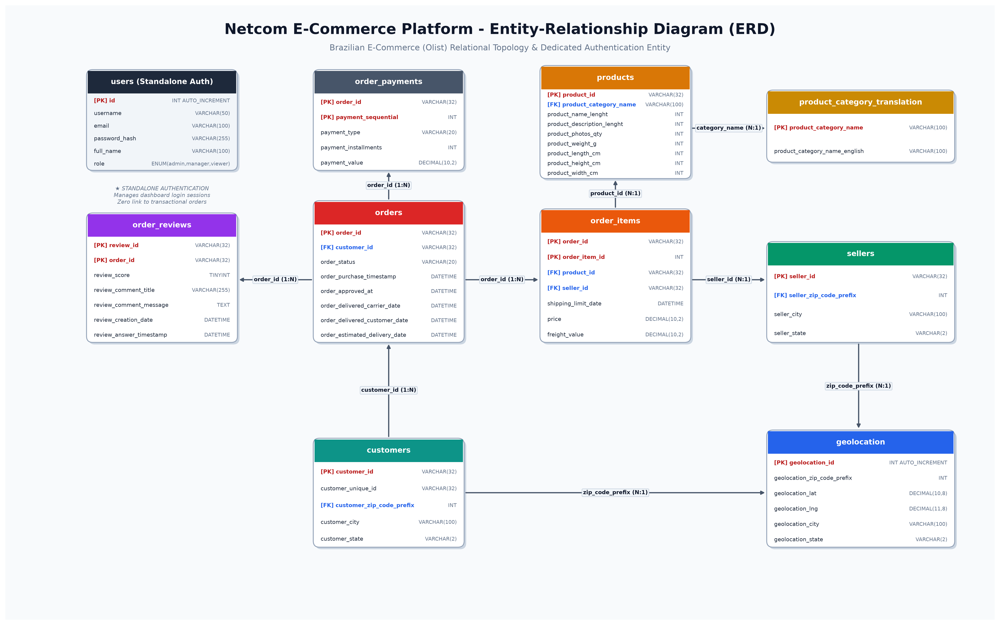

# Netcom Analytics — Platform Intelijen E-Commerce Brasil

Platform analitik *full-stack*, dasbor operasional, dan mesin data relasional berkinerja tinggi yang dibangun untuk mengolah transaksi e-commerce Brasil dalam skala besar (1,45 juta baris data pada 9 entitas relasional).



---

## Ringkasan Proyek

Platform ini dirancang untuk mengeksekusi *query* relasional berkecepatan tinggi, pelacakan pendapatan berbasis runtun waktu (*time series*), deteksi anomali statistik, pemantauan antrean pemenuhan pesanan (*fulfillment queue*), dan manajemen data CRUD dinamis. Arsitekturnya mengedepankan modularitas yang bersih, penegakan integritas data yang ketat pada level basis data, manajemen *connection pooling*, serta kontrol akses berbasis peran (*Role-Based Access Control* / RBAC).

### Tech Stack
* **Backend:** Python 3, Flask RESTful API, PyMySQL dengan *connection pooling* `DBUtils`, *hashing* kata sandi Argon2, autentikasi PyJWT, serta pustaka kalkulasi statistik NumPy dan SciPy.
* **Basis Data:** MySQL 8.0 (*engine* InnoDB, *charset* UTF8MB4, *composite primary key*, batasan *foreign key*, dan kolom pencarian terindeks B-Tree).
* **Frontend:** React 19, Vite 8, Tailwind CSS, Chart.js & react-chartjs-2, serta ikon antarmuka Lucide.
* **Keamanan & Tata Kelola:** Token JWT Bearer, enkripsi Argon2, dan *middleware* proteksi hak akses peran (`admin`, `manager`, `viewer`).

---

## Struktur Repositori

```text
netcom/
├── backend/
│   ├── analytics/              # Rute analitik omzet, deteksi anomali, dan pemenuhan pesanan
│   ├── auth/                   # Autentikasi JWT, hashing Argon2, dan penegakan RBAC
│   ├── crud/                   # Introspeksi skema universal dan endpoint operasi CRUD
│   ├── app.py                  # Factory aplikasi Flask dan registrasi blueprint
│   ├── config.py               # Pengelola konfigurasi variabel lingkungan
│   ├── db.py                   # Manajemen connection pool PooledDB dan helper query
│   ├── init_db.py              # Inisialisasi skema basis data dan skrip migrasi CSV
│   ├── test_api.py             # Rangkaian pengujian otomatis (10 pengujian end-to-end)
│   ├── requirements.txt        # Daftar dependensi Python backend
│   ├── .env.example            # Templat konfigurasi variabel lingkungan
│   └── netcom_api_collection.postman_collection.json # Koleksi pengujian Postman v2.1.0
├── dataset_technical_test_netcom/ # Berkas dataset mentah format CSV
├── frontend/
│   ├── src/
│   │   ├── components/         # Komponen UI modular (Navbar, Sidebar, Skeleton, EmptyState)
│   │   ├── context/            # AuthContext (state pengguna dan token JWT)
│   │   ├── pages/              # Halaman Overview, Revenue, Anomalies, Orders, CRUD, Architecture
│   │   ├── api.js              # Klien HTTP Axios dengan interceptor token otomatis
│   │   └── App.jsx             # Router aplikasi dan layout shell terproteksi
│   ├── index.html              # Titik masuk HTML aplikasi web
│   ├── package.json            # Konfigurasi dependensi dan skrip eksekusi frontend
│   └── vite.config.js          # Konfigurasi bundler Vite dan reverse proxy backend
├── erd.png                     # Diagram Relasi Entitas (ERD) resolusi tinggi (300 DPI)
├── netcom_ecommerce_dump.sql.gz # Berkas dump database terkompresi (1,45 juta baris, 39.4 MB)
├── schema.sql                  # Definisi skema DDL dan konstrain foreign key
└── README.md                   # Dokumentasi sistem dan buku panduan operasional
```

---

## Fitur Utama & Hasil Pengerjaan

| Modul / Kebutuhan | Deskripsi Implementasi | Lokasi Berkas |
| :--- | :--- | :--- |
| **Mesin CRUD Universal** | Operasi Create, Read, Update, Delete penuh dengan pencarian, paginasi, dan pengurutan pada 9 tabel | [frontend/src/pages/CrudManager.jsx](frontend/src/pages/CrudManager.jsx)<br>[backend/crud/routes.py](backend/crud/routes.py) |
| **Autentikasi & RBAC** | Sistem login aman berbasis peran (Admin, Manager, Viewer) menggunakan enkripsi Argon2 dan token JWT | [frontend/src/pages/Login.jsx](frontend/src/pages/Login.jsx)<br>[backend/auth/routes.py](backend/auth/routes.py) |
| **Analitik Pendapatan Harian** | Runtun waktu pendapatan harian dengan filter bulan dan tahun serta visualisasi korelasi volume pesanan sumbu ganda | [frontend/src/pages/RevenueAnalytics.jsx](frontend/src/pages/RevenueAnalytics.jsx)<br>[backend/analytics/routes.py](backend/analytics/routes.py) |
| **Deteksi Anomali Statistik** | Deteksi lonjakan ekstrem parametrik (Z-Score) & non-parametrik (IQR) yang menyorot peristiwa Black Friday 2017 | [frontend/src/pages/AnomalyDetection.jsx](frontend/src/pages/AnomalyDetection.jsx)<br>[backend/analytics/routes.py](backend/analytics/routes.py) |
| **Antrean Pesanan Belum Terkirim** | Dasbor operasional pemantauan pesanan pending yang dilengkapi indikator urgensi kepatuhan batas waktu pengiriman (SLA) | [frontend/src/pages/UnshippedOrders.jsx](frontend/src/pages/UnshippedOrders.jsx)<br>[backend/analytics/routes.py](backend/analytics/routes.py) |
| **Diagram Relasi Entitas (ERD)** | Pemodelan relasional 9 entitas yang dinormalisasi dengan tabel pesanan (*orders*) sebagai pusat transaksi (300 DPI) | [erd.png](erd.png) |
| **Database Dump Lengkap** | Berkas dump MySQL yang memuat skema DDL, indeks teroptimasi, serta seluruh 1.450.927 data transaksi | [netcom_ecommerce_dump.sql.gz](netcom_ecommerce_dump.sql.gz) |
| **Arsitektur Skalabilitas 100x** | Cetak biru arsitektur penskalaan (partisi data, *caching* Redis, mesin analitik ClickHouse OLAP, dan CDC Kafka) | Bagian [Strategi Skalabilitas](#strategi-skalabilitas-100x-150-juta-data) & Dasbor |

---

## Arsitektur Basis Data & Pemodelan Data

### Topologi Relasi Antar Tabel
* **Pusat Transaksi (`orders`):** Menghubungkan entitas anak `order_items`, `order_payments`, dan `order_reviews` melalui relasi satu-ke-banyak (1:N) dengan *foreign key* `order_id`.
* **Pelanggan & Merchant:** Menghubungkan `orders.customer_id` &rarr; `customers.customer_id` serta `order_items.seller_id` &rarr; `sellers.seller_id`.
* **Katalog & Kategori Produk:** Menghubungkan `order_items.product_id` &rarr; `products.product_id` serta nama kategori `products.product_category_name` &rarr; `product_category_translation.product_category_name`.
* **Pemetaan Geospasial:** Kolom `customer_zip_code_prefix` dan `seller_zip_code_prefix` terhubung ke data koordinat `geolocation.geolocation_zip_code_prefix`.
* **Isolasi Entitas Autentikasi:** Tabel `users` dipisahkan secara ketat dari alur transaksi komersial guna menjamin integritas dan keamanan administratif dasbor.

### Verifikasi Data yang Dimuat ke Basis Data

| Nama Tabel | Jumlah Data | Primary Key | Relasi Foreign Key | Keterangan Data |
| :--- | :---: | :--- | :--- | :--- |
| `users` | **3** | `id` (AUTO_INCREMENT) | Tidak ada (Terisolasi) | Pengguna dasbor dan hak akses peran |
| `product_category_translation` | **73** | `product_category_name` | Tidak ada | Terjemahan kategori produk (Portugis &rarr; Inggris) |
| `customers` | **99.441** | `customer_id` | `customer_zip_code_prefix` | Identitas unik pembeli dan lokasi domisili |
| `sellers` | **3.095** | `seller_id` | `seller_zip_code_prefix` | Direktori mitra penjual (*merchants*) dan wilayah asal |
| `products` | **32.951** | `product_id` | `product_category_name` | Dimensi fisik produk, berat, foto, dan kategori |
| `orders` | **99.441** | `order_id` | `customer_id` | Siklus status pesanan dan catatan waktu pemrosesan |
| `order_items` | **112.650** | `(order_id, order_item_id)` | `order_id`, `product_id`, `seller_id` | Rincian barang pesanan, harga jual, dan tarif ongkos kirim |
| `order_payments` | **103.886** | `(order_id, payment_sequential)` | `order_id` | Transaksi tender (kartu kredit, boleto, voucher, debit) |
| `order_reviews` | **99.224** | `review_id` | `order_id` | Skor kepuasan pelanggan (1-5 bintang) dan ulasan teks |
| `geolocation` | **1.000.163** | `geolocation_id` (AUTO_INCREMENT) | Dirujuk oleh awalan kode pos | Data koordinat GPS lintang/bujur, kota, dan negara bagian |
| **Total Baris Data** | **1.450.927** | — | — | **100% Integritas Relasional Terverifikasi** |

---

## Implementasi Fitur

### 1. Mesin CRUD Universal
* **Introspeksi Skema Dinamis:** Backend secara otomatis membaca metadata tabel dari `INFORMATION_SCHEMA.COLUMNS` untuk merender struktur form, tipe input, validasi, dan kolom data secara dinamis.
* **Dukungan Kunci Primer Majemuk (*Composite Primary Key*):** Menangani relasi multi-kunci secara tepat pada tabel seperti `order_items` (`order_id`, `order_item_id`) dan `order_payments` (`order_id`, `payment_sequential`).
* **Paginasi & Pencarian Sisi Server:** Mengoptimalkan performa tabel data besar dengan paginasi `LIMIT / OFFSET`, pengurutan kolom instan (`ORDER BY`), serta pencarian multibaris berbasis `LIKE`.

### 2. Analitik Pendapatan Harian
* **Filter Waktu Interaktif:** Pilihan penelusuran fleksibel berdasarkan tahun (2016, 2017, 2018, atau Seluruh Tahun) dan bulan (Januari s.d. Desember, atau Seluruh Bulan).
* **Grafik Visual Sumbu Ganda (*Dual-Axis Chart*):** Memvisualisasikan total omzet penjualan harian (dalam mata uang Real Brasil / R$) berdampingan dengan kurva volume transaksi pesanan.
* **Buku Kas Harian (*Financial Ledger*):** Tabel rincian harian yang mencakup omzet barang, biaya ongkir, pendapatan kotor, jumlah unit terjual, dan nilai rata-rata pesanan (*Average Order Value* / AOV) yang dapat diekspor ke CSV dalam sekali klik.

### 3. Deteksi Anomali Statistik
* **Mesin Z-Score (Pendekatan Parametrik):** Mengukur deviasi omzet harian terhadap nilai rata-rata bergulir dan standar deviasi ($Z = \frac{x - \mu}{\sigma}$). Nilai ambang batas (*threshold*) dapat disesuaikan pengguna dari $2,0\sigma$ hingga $3,5\sigma$.
* **Mesin IQR Boxplot (Pendekatan Non-Parametrik):** Kuat terhadap kemiringan distribusi data (*skewness*) dengan menggunakan ambang kuartil atas ($Q_3 + 1,5 \times IQR$).
* **Identifikasi Black Friday 2017:** Secara presisi menandai tanggal **24 November 2017** sebagai hari rekor penjualan tertinggi sepanjang sejarah data (omzet R\$ 152.653,74 dengan 1.166 pesanan, lonjakan Z-Score **+12,13**, atau $+10,44\sigma$ di atas rata-rata), diikuti lonjakan bawaan pada akhir pekan tanggal 25 November 2017.

### 4. Manajemen Pemenuhan Pesanan Belum Terkirim
* **Cakupan Pengawasan:** Melacak seluruh pesanan aktif yang belum selesai dikirim ke pelanggan (`invoiced`, `processing`, `created`, `approved`, `unavailable` — total 1.233 pesanan).
* **Pengawasan Batas Waktu SLA:** Menghitung sisa waktu pengiriman terhadap tanggal estimasi (`order_estimated_delivery_date`) dengan indikator warna status (`Dalam SLA`, `Normal`, `Mendesak/Terlambat`).
* **Pembaruan Status Cepat:** Memberikan wewenang kepada peran Admin dan Manager untuk mengubah status alur pesanan (`Mark Shipped`, `Mark Delivered`, `Cancel Order`) dengan pembaruan antarmuka secara *real-time*.

---

## Strategi Skalabilitas 100x (150 Juta+ Data)

Ketika volume transaksi bertumbuh dari 1,45 juta data menjadi **150 juta data lebih** dengan ribuan pengguna konkuren, basis data relasional monolitik tunggal akan mengalami kemacetan parah pada *table lock*, kedalaman indeks B-Tree, saturasi I/O disk, dan kehabisan alokasi *connection pool*.

Arsitektur bertingkat berikut diterapkan guna mempertahankan waktu respons di bawah 100 milidetik dengan tingkat ketersediaan 99,99%:

```text
                          ┌──────────────────────────┐
                          │     Edge CDN Global      │
                          │ Cloudflare / CloudFront  │
                          │  (Aset Statis & Cache)   │
                          └─────────────┬────────────┘
                                        │
                                        ▼
                          ┌──────────────────────────┐
                          │    ALB / Nginx Proxy     │
                          │   Rate Limiting & SSL    │
                          └─────────────┬────────────┘
                                        │
                    ┌───────────────────┴───────────────────┐
                    │                                       │
                    ▼                                       ▼
      ┌──────────────────────────┐            ┌──────────────────────────┐
      │  App Pod 1 (FastAPI/Py)  │            │  App Pod N (FastAPI/Py)  │
      │   Horizontal Autoscaling │            │   Horizontal Autoscaling │
      └─────────────┬────────────┘            └─────────────┬────────────┘
                    │                                       │
                    ├───────────────────┬───────────────────┤
                    │                   │                   │
                    ▼                   ▼                   ▼
      ┌──────────────────────────┐┌───────────┐┌──────────────────────────┐
      │      Redis Cluster       ││ ProxySQL  ││   Kafka + Debezium CDC   │
      │   In-Memory Cache & Lock ││Multiplexing││  Change Data Capture    │
      └──────────────────────────┘└─────┬─────┘└────────────┬─────────────┘
                                        │                   │
                  ┌─────────────────────┴───────┐           │
                  │                             │           │
                  ▼                             ▼           ▼
      ┌──────────────────────────┐┌───────────────────────┐┌──────────────┐
      │ Primary MySQL (OLTP)     ││ Read Replica Cluster  ││ ClickHouse   │
      │ Partisi Rentang per Tahun││ (1:3 Node Multi-AZ)   ││ (Mesin OLAP) │
      └──────────────────────────┘└───────────────────────┘└──────────────┘
```

### 1. Partisi Basis Data & Replikasi Baca (Read Replicas)
* **Partisi Rentang Berdasarkan Waktu (*Range Partitioning*):** Mempartisi tabel transaksi `orders` dan `order_items` berdasarkan fungsi `YEAR(order_purchase_timestamp)` dan `MONTH`. Mekanisme *query pruning* pada MySQL hanya akan membaca partisi bulan target yang relevan, memangkas pemindaian baris dari 150 juta menjadi hanya ~1,2 juta baris data.
* **Pemisahan Jalur Baca & Tulis (*Read/Write Splitting*):** Memasang ProxySQL di depan 1 Master Primary Writer dan 3 Read Replicas. Perintah mutasi (`INSERT`, `UPDATE`, `DELETE`) diarahkan ke Master, sementara seluruh *query* analitik yang intensif diarahkan ke Read Replicas.
* **Multiplexing Koneksi Basis Data:** Menggunakan pustaka `PooledDB` dan ProxySQL untuk melakukan multiplexing koneksi, menjaga *active thread* basis data tetap stabil di kisaran ~200 koneksi meskipun melayani 10.000+ pengguna simultan.

### 2. Lapisan Caching Dalam Memori (Redis Cluster)
* **Pre-Agregasi Ringkasan Finansial Harian:** Nilai omzet dan anomali harian disimpan di Redis dengan format kunci `rev:daily:YYYY-MM`. Data bulan-bulan yang telah lewat di-*cache* secara permanen, sementara data bulan berjalan memiliki TTL 3 menit dengan pola pembaharuan *cache-aside*.
* **Validasi Token Instan:** Metadata sesi dan daftar pembatalan token JWT divalidasi langsung melalui Redis dalam waktu kurang dari 0,5 milidetik per request.
* **Pembatasan Laju Akses (*Sliding-Window Rate Limiting*):** Script Lua di Redis membatasi akses request per alamat IP (100 req/menit) untuk mencegah serangan bot dan scraping berlebih.

### 3. Mesin Analitik Kolumnar (ClickHouse / BigQuery)
* **Pemisahan Beban OLTP dan OLAP:** Beban transaksi harian ACID tetap ditangani MySQL. Setiap perubahan data ditangkap secara *real-time* dari binlog MySQL menggunakan **Debezium CDC** dan dialirkan melalui **Apache Kafka**.
* **Eksekusi Analitik Vektorisasi:** Data dari Kafka diserap oleh **ClickHouse**. Dengan penyimpanan berbasis kolom (*columnar storage*) dan kompresi LZ4, ClickHouse dapat menghitung kalkulasi Z-Score di atas 150 juta baris data dalam tempo **kurang dari 80 milidetik** (dibandingkan ~45 detik pada MySQL berbasis baris standar).

### 4. Pre-Agregasi Titik Tengah Geospasial (*Geolocation Centroids*)
* Pada data mentah, tabel `geolocation` memuat 1.000.163 data koordinat GPS untuk ~19.000 variasi kode pos unik.
* *Optimasi:* Membuat tabel agregat terindeks `geolocation_centroids` yang mengelompokkan awalan kode pos dan menghitung rata-rata `AVG(latitude)` serta `AVG(longitude)`. Langkah ini menyusutkan 1 juta baris menjadi 19.015 titik data terindeks, melenyapkan beban *Cartesian join* N:M secara drastis.

---

## Panduan Instalasi & Menjalankan Aplikasi

### 1. Prasyarat Sistem
* **Python:** Versi 3.10 atau lebih baru
* **Node.js:** Versi 18 atau lebih baru (direkomendasikan Node.js 20)
* **Basis Data:** MySQL Server 8.0+ berjalan pada `127.0.0.1:3306`

---

### 2. Penyiapan Basis Data

Buat basis data target pada MySQL:
```sql
CREATE DATABASE IF NOT EXISTS netcom_ecommerce_db CHARACTER SET utf8mb4 COLLATE utf8mb4_unicode_ci;
```

**Pilihan A — Restore dari Berkas Dump Database (Direkomendasikan & Tercepat):**
```bash
# Pada Windows (menggunakan bawaan tar):
tar -xzf netcom_ecommerce_dump.sql.gz
mysql -u <username_mysql_anda> -p netcom_ecommerce_db < netcom_ecommerce_dump.sql

# Pada Linux / macOS:
gzip -d < netcom_ecommerce_dump.sql.gz | mysql -u <username_mysql_anda> -p netcom_ecommerce_db
```

**Pilihan B — Ingesti dari Berkas Mentah CSV:**
```bash
cd backend
python init_db.py
```

---

### 3. Penyiapan Backend

1. Masuk ke direktori backend dan instal dependensi Python:
   ```bash
   cd backend
   pip install -r requirements.txt
   ```

2. Buat berkas konfigurasi lingkungan dari templat yang tersedia:
   ```bash
   cp .env.example .env
   ```
   *(Pada Windows PowerShell: `Copy-Item .env.example .env`)*

   Sesuaikan kredensial basis data pada `backend/.env` apabila berbeda dengan pengaturan lokal Anda:
   ```ini
   DB_HOST=127.0.0.1
   DB_PORT=3306
   DB_USER=root
   DB_PASSWORD=password_mysql_anda
   DB_NAME=netcom_ecommerce_db
   JWT_SECRET=rahasia-kunci-jwt-produksi-anda
   PORT=5000
   ```

3. Jalankan rangkaian pengujian otomatis untuk memverifikasi koneksi database dan API:
   ```bash
   python test_api.py
   ```
   *Hasil pengujian yang diharapkan:*
   ```text
   ============================================================
   NETCOM E-COMMERCE ANALYTICS & CRUD API TEST SUITE
   ============================================================
   [PASS] 1. /api/health - Database connected
   [PASS] 2. Login verification: admin (admin)
   [PASS] 2. Login verification: manager (manager)
   [PASS] 2. Login verification: viewer (viewer)
   [PASS] 3. /api/auth/me - Token validation passed
   [PASS] 4. /api/crud/datasets - All 9 datasets listed (9 tables)
   [PASS] 5. /api/crud/customers - Schema inspected and paginated (Total: 99441)
   [PASS] 6. /api/analytics/overview - KPIs verified (Orders: 99441, Rev: R$ 13,591,643.70)
   [PASS] 7. /api/analytics/daily-revenue - November 2017 Peak verified on 2017-11-24 (R$ 152,653.74)
   [PASS] 8. /api/analytics/anomalies - Black Friday 2017 detected (Z-Score: 12.13)
   [PASS] 9. /api/analytics/unshipped-orders - Operational queue verified (1233 unshipped orders)
   [PASS] 10. RBAC Protection - Viewer forbidden from PATCH status (HTTP 403 verified)
   ============================================================
   All 10 API test suites passed successfully.
   ============================================================
   ```

4. Jalankan server API backend:
   ```bash
   python app.py
   ```
   *Server backend berjalan di:* `http://127.0.0.1:5000`

---

### 4. Penyiapan Frontend

1. Buka terminal baru, masuk ke direktori frontend, dan pasang seluruh paket dependensi:
   ```bash
   cd frontend
   npm install
   ```

2. Jalankan server pengembangan Vite:
   ```bash
   npm run dev
   ```
   *Aplikasi web dapat diakses langsung pada:* `http://localhost:3000`

3. *(Opsional)* Kompilasi untuk kebutuhan rilis produksi:
   ```bash
   npm run build
   ```

---

## Akun Uji Coba Default

| Username | Password | Peran (*Role*) | Cakupan Hak Akses |
| :--- | :--- | :---: | :--- |
| **`admin`** | `Admin@123` | **`admin`** | Akses Penuh: Menambah, mengubah, dan menghapus seluruh tabel CRUD, memperbarui status pesanan, melihat seluruh analitik, dan melihat skema data. |
| **`manager`** | `Manager@123` | **`manager`** | Akses Operasional: Menambah dan mengubah data CRUD, memperbarui alur status pesanan, dan melihat seluruh analitik. |
| **`viewer`** | `Viewer@123` | **`viewer`** | Akses Hanya Baca: Hanya dapat melihat metrik, grafik, dan tabel data tanpa izin mengubah data. |

---

## Ringkasan Endpoint API

### Autentikasi (`/api/auth`)
* `POST /api/auth/login` — Autentikasi kredensial pengguna; mengembalikan token JWT dan profil peran.
* `GET /api/auth/me` — Membaca klaim sesi dan data pengguna yang sedang aktif.
* `GET /api/auth/users` — Daftar akun pengguna terdaftar (Khusus Admin).

### Mesin CRUD Universal (`/api/crud`)
* `GET /api/crud/datasets` — Menampilkan daftar 9 tabel dataset beserta jumlah data aktual.
* `GET /api/crud/schema/<dataset>` — Memeriksa struktur kolom, tipe data, dan primary key tabel.
* `GET /api/crud/<dataset>?page=1&per_page=25&search=...&sort_by=...&sort_order=...` — Menampilkan data terpaginasi, tersortir, dan terfilter.
* `GET /api/crud/<dataset>/<id>` — Mengambil satu baris rekaman berdasarkan ID (atau composite key).
* `POST /api/crud/<dataset>` — Membuat baris rekaman baru (Admin/Manager).
* `PUT /api/crud/<dataset>/<id>` — Memperbarui data rekaman yang dipilih (Admin/Manager).
* `DELETE /api/crud/<dataset>/<id>` — Menghapus data rekaman (Khusus Admin).

### Analitik & Pemenuhan Pesanan (`/api/analytics`)
* `GET /api/analytics/overview` — Metrik KPI eksekutif (total omzet, jumlah pesanan, total pembeli, ulasan, persebaran metode pembayaran).
* `GET /api/analytics/daily-revenue?year=2017&month=11` — Data runtun waktu omzet harian dan volume pesanan.
* `GET /api/analytics/anomalies?year=2017&method=zscore&threshold=2.5` — Daftar deteksi anomali lonjakan transaksi statistik.
* `GET /api/analytics/unshipped-orders?page=1&page_size=20&status=...` — Antrean operasional pesanan tertunda lengkap dengan metrik latensi SLA.
* `PATCH /api/analytics/orders/<order_id>/status` — Memperbarui tahapan siklus pesanan (`shipped`, `delivered`, `canceled`).

---

## Pengujian & Perangkat Bantu
* **Rangkaian Pengujian Otomatis:** Eksekusi perintah `python backend/test_api.py` untuk menjalankan 10 skenario pengujian endpoint backend secara komprehensif.
* **Koleksi Postman:** Impor berkas [backend/netcom_api_collection.postman_collection.json](backend/netcom_api_collection.postman_collection.json) (v2.1.0) ke aplikasi Postman untuk pengujian instan dengan mekanisme *auto-token capture*. Rincian panduan penggunaan dapat dibaca pada [backend/README_API.md](backend/README_API.md).
